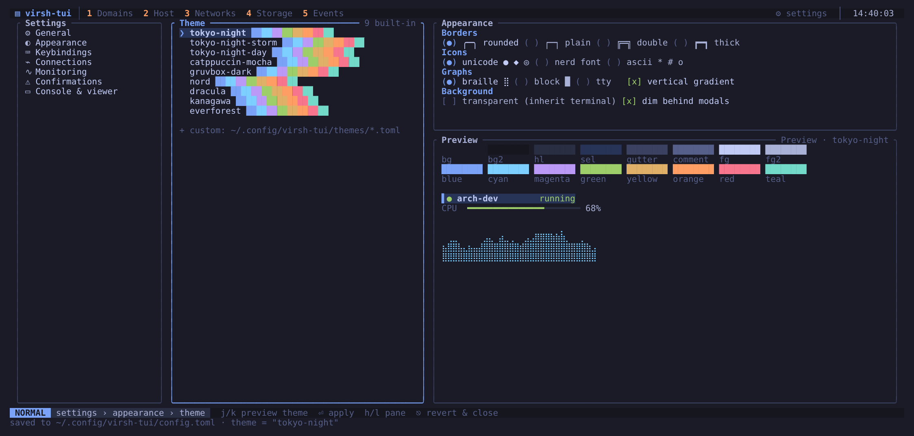
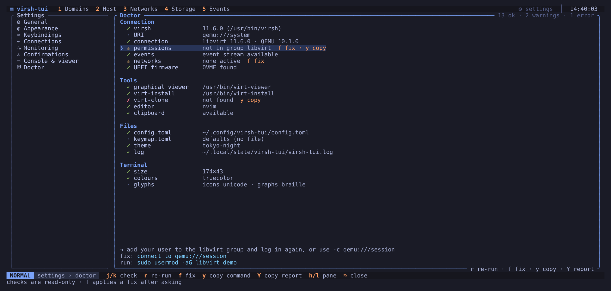
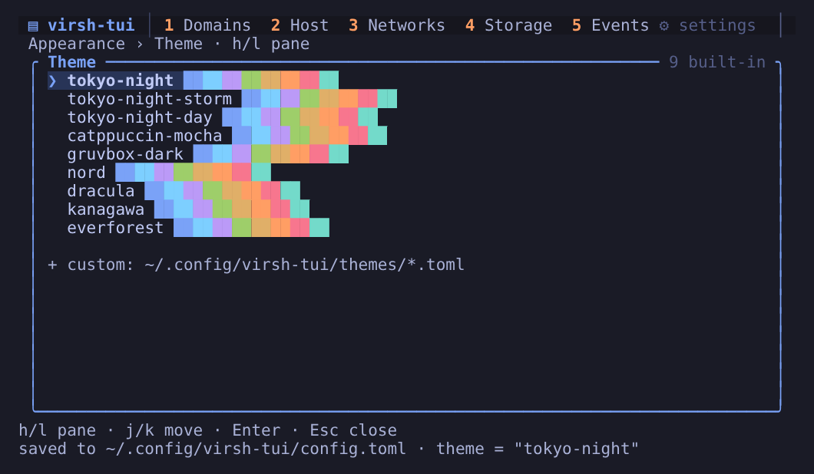

# Configuration

virsh-tui reads `~/.config/virsh-tui/config.toml` (or `$XDG_CONFIG_HOME`).
The file is optional; every key has a default. The settings screen (`,`) and
`:set key=value` write changes back to the same file, so you rarely need to
edit it by hand. `--config <path>` uses another file, and changes made in
the app are saved there.



## Full example with the defaults

```toml
[general]
default_uri = "qemu:///system"   # used when -c/--connect is not given
refresh_interval_secs = 1        # how often stats are sampled
editor = "vi"                    # used when $VISUAL and $EDITOR are unset
start_view = "domains"           # domains, host, networks, storage, events
key_hints = true                 # key hints in bars, panels and dialogs
default_sort = "state"           # state, name, cpu, mem, uptime
default_filter = "all"           # all, running, paused, crashed, off
history_size = 500               # `:` lines kept across sessions; 0: not saved
shutdown_timeout_secs = 90       # wait this long after S before warning
log_level = "info"               # error, warn, info, debug, trace, off

[appearance]
theme = "tokyo-night"            # built-in name or a file in themes/
transparent = false              # use the terminal background
borders = "rounded"              # rounded, plain, double, thick
icons = "unicode"                # unicode, nerd, ascii
graphs = "braille"               # braille, block, tty
gradient = true                  # colour bars by level (green, yellow, red)
dim_modals = true                # dim the screen behind dialogs

[connections]
uris = [                         # offered by :connect completion and Settings
  "qemu:///system",
  "qemu:///session",
  # add remote hosts here, e.g. "qemu+ssh://admin@server/system"
]
default = "qemu:///system"

[monitoring]
balloon_on = false               # set a balloon stats period on running guests
balloon_period_secs = 2
thread_sampling = true           # per-thread CPU meters in the Host view
history_window = "60s"           # graph window at start: 60s, 5m, 1h

[confirmations]
destroy = true
reset = true
undefine = true
revert = true                    # snapshot revert
delete_volume = true
wipe = true
type_name_for_undefine = true    # type the domain name to undefine
bulk_threshold = 0               # always ask from this many marked domains; 0: off

[console]
viewer = "virt-viewer"           # or "remote-viewer"
escape = "C-]"                   # key that leaves the serial console

[wizard]
iso_dirs = []                    # folders the ISO picker scans; empty: the
                                 # XDG download folder, e.g. ["~/Downloads", "/srv/isos"]
```

## Notes on some settings

`monitoring.balloon_on` is off by default because it runs
`virsh dommemstat --period N --live` on running domains, which changes their
configuration. Without it, the memory graphs show what libvirt reports
without a stats period: the balloon size and RSS, but not the guest's own
view of free memory.

`console.viewer = "remote-viewer"` makes `v` ask libvirt for the display URI
(`virsh domdisplay`) and open it with `remote-viewer`. Any other value uses
`virt-viewer -c <uri> <domain>`.

`wizard.iso_dirs` lists the folders the new-domain wizard's ISO picker
reads (one level deep, `*.iso`). `~/` is expanded. When it is empty, the
picker uses your download folder as `xdg-user-dirs` reports it, so a
localized name works without configuration. Folders are only read for local
connections.

`general.default_sort`, `general.default_filter` and
`monitoring.history_window` set how the domain list and the graphs open;
`o`, `f` and `t` still change them for the session.

`general.history_size` keeps the last lines typed at `:` in
`~/.local/state/virsh-tui/history` (mode 0600), so `Up` recalls them after a
restart. A line that starts with a space is kept for the session only, like
`HISTCONTROL=ignorespace` in bash: use it for arguments you do not want on
disk. `0` stops saving and empties the file; turning it back on takes effect
at the next start. The demo neither reads nor writes the file.

`general.shutdown_timeout_secs` is how long virsh-tui watches a domain after
`S` before saying that the guest ignored the ACPI request.

`general.log_level` sets the detail of the log file. `RUST_LOG` still
overrides it, and a change takes effect at the next start.

`confirmations.bulk_threshold` is a safety net for the toggles above: with
`destroy = false`, `D` on one domain runs at once, but with
`bulk_threshold = 3` it asks again as soon as three or more domains are
marked. It applies to destroy, reset, undefine, delete volume and wipe.
Lifecycle actions on several domains (start, shutdown, reboot, …) always
show the commands first.

`console.escape` accepts `C-x` or `^x` notation and is passed to
`virsh console` as `-e ^x`.

The editor is chosen in this order: `$VISUAL`, `$EDITOR`,
`general.editor`, then `vi`. Values with arguments work, for example
`code --wait`.

## Settings screen

`,` opens the settings. The categories on the left are General, Appearance,
Keybindings, Connections, Monitoring, Confirmations, Console & viewer, and
Doctor;
it opens on General with the category list focused (`Enter` or `l` enters a
category). `j` and `k` move through the options; in the theme list they also preview the
theme live. `Enter` applies and saves, `h` and `l` switch panes, `Esc`
reverts unsaved previews and closes.

Keybindings lists every remappable action with its keys and lets you change
them in place; see [Remapping keys](keys.md#from-the-settings).

### Doctor



Doctor checks the environment and says what to do about each problem: the
`virsh` client, the connection and your permissions on it, the event stream,
active networks, UEFI firmware, the graphical viewer, `virt-install` and
`virt-clone`, the editor, the clipboard, `config.toml`, `keymap.toml`, the
theme, the log file and the terminal (size, colours, glyph settings).
`:doctor` opens it directly, and `virsh-tui --doctor` prints the same report
in the shell (see [Troubleshooting](troubleshooting.md)).

The checks only read: they run `virsh` queries, look up programs in `PATH`
and read files. They start when the category is shown; `r` runs them again.
The selected row shows its hint below the list:

- `f` applies a fix that virsh-tui can do itself, after asking: set
  `default_uri` to your `LIBVIRT_DEFAULT_URI`, switch the viewer to the one
  you have installed, go back to the default theme, connect to
  `qemu:///session` when `qemu:///system` refuses you, start and autostart
  the inactive `default` network (the usual confirmation with the
  commands), or open a broken `config.toml` / `keymap.toml` in the editor.
- `y` copies the command for a fix that needs root, such as
  `sudo usermod -aG libvirt <user>`, `sudo systemctl enable --now …` or the
  package install for your distribution (Arch, Debian/Ubuntu, Fedora/RHEL,
  openSUSE). virsh-tui never runs these itself.
- `Y` copies the whole report, ready to paste into a bug report.

Being outside the `libvirt` group is only a warning when the connection
fails; polkit can grant access without it. After you fix `config.toml`,
the row says `fixed on disk; restart virsh-tui to load it` until the next
start.

General › **key hints** turns off the key hints once you know the keys
(`:set key_hints=false` does the same): the status bars, the actions under the
selected domain, panel footers and the key lines of the palette, ISO picker,
wizard and hardware editor. The mode pill, breadcrumb and dialog buttons
(`y confirm`, `⏎ create`, …) stay, and `?` still lists every key.

## `:set`

`:set` changes one setting and saves the file:

```text
:set theme=nord
:set graphs=block
:set refresh_interval_secs=2
:set default_uri=qemu:///session
```

Supported keys: `theme`, `transparent`, `borders`, `icons`, `graphs`,
`gradient`, `dim_modals`, `key_hints`, `default_uri`, `editor`, `start_view`, `viewer`,
`escape`, `refresh_interval_secs`, `default_sort`, `default_filter`,
`history_size`, `history_window`, `shutdown_timeout_secs`, `bulk_threshold`
and `log_level`. `Tab` completes them. Values are checked
(booleans take `true`/`false`, `refresh_interval_secs` 1-60, `viewer`
`virt-viewer` or `remote-viewer`, …); a rejected value changes nothing. A new
value takes effect at once: a new refresh interval restarts sampling, and the
history windows (`t`: 60 s / 5 min / 1 h) keep their length in time.

If `config.toml` cannot be parsed, virsh-tui starts on defaults, says so in
the message line, and does not save over the file until it is fixed. The
file is written atomically (a temporary file renamed over it).


### Compact Settings



Below 140 columns Settings shows one active pane at a time. Use `h/l` to
move between categories, themes and appearance options; `j/k` selects a row.
The current row stays visible as the list scrolls. `Enter` applies a theme
and `Esc` reverts an uncommitted theme preview and closes Settings.
