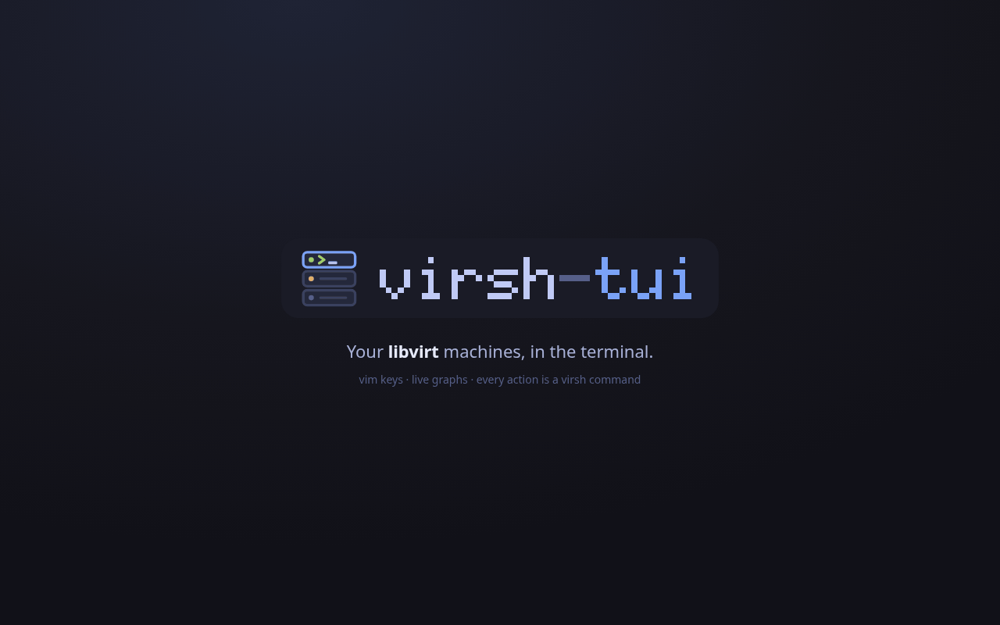

# virsh-tui

virsh-tui is a terminal user interface for [libvirt](https://libvirt.org). It
lists your virtual machines with live CPU, memory, disk and network graphs, and
lets you start, stop, snapshot, reconfigure and create them without leaving the
keyboard. The key bindings follow vim: `j`/`k` to move, `:` for commands, `/`
to filter, a leader key for less common actions.

Under the hood every action is a `virsh` (or `virt-install`) command. The
interface shows the exact command before and after it runs, so you can copy it
into a script, check what a button does, or learn the `virsh` syntax as you go.
Nothing talks to libvirt through a private API: if `virsh` can do it on your
machine, virsh-tui can do it, with the same permissions.

## What it covers

- Domains: a sortable, filterable list with per-domain CPU bars, lifecycle
  actions (start, ACPI shutdown, destroy, reboot, reset, pause, managed save),
  bulk actions on marked domains, tags, migration, serial console and
  graphical viewer.
- Domain detail: overview, live monitor with 60 s / 5 min / 1 h history,
  a hardware editor that shows the XML diff and the commands it will run,
  snapshots with a diff against the current configuration, guest agent
  info, console and XML.
- Host: CPU per thread, memory, hugepages, KSM, swap, storage pools and
  networks at a glance.
- Networks: definitions, DHCP leases, static host entries and attached
  interfaces.
- Storage: pools (and a dialog to create them), volumes with backing chains
  and owners, ISO media insertion and ejection.
- Events: the libvirt event stream for domains, networks and pools, and
  notifications when a domain crashes or a long job finishes.
- A six-step wizard that builds a `virt-install` command for new domains.
- A `:` command line with Tab completion for commands, domain names, themes,
  paths and every `virsh` flag, and a fuzzy command palette.
- Nine built-in themes plus custom themes, remappable keys, and a settings
  screen that writes back to your config file.
- Custom actions, per-connection profiles, a read-only mode, and a doctor
  (`--doctor`) that checks your setup and explains each fix.

## Who it is for

People who already use `virsh` and want a faster way to see and drive many
domains at once. It runs anywhere `virsh` runs, including over
`qemu+ssh://` connections to remote hosts.

## Trying it without libvirt

`virsh-tui --demo` starts with an in-memory backend full of example domains,
networks and pools. Nothing is executed, so it is a safe way to look around.
All screenshots in this book come from demo mode.
