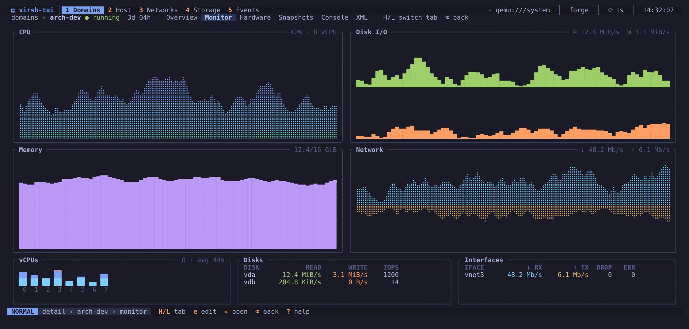
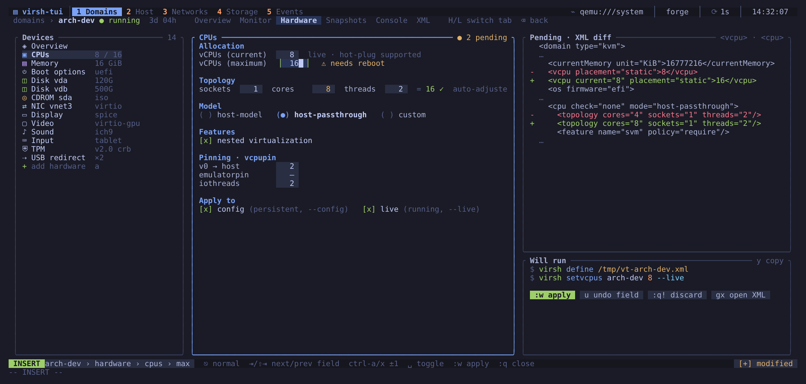
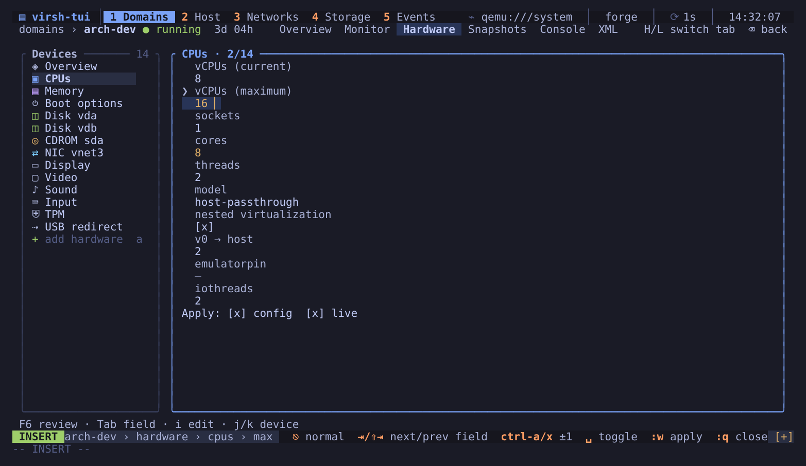
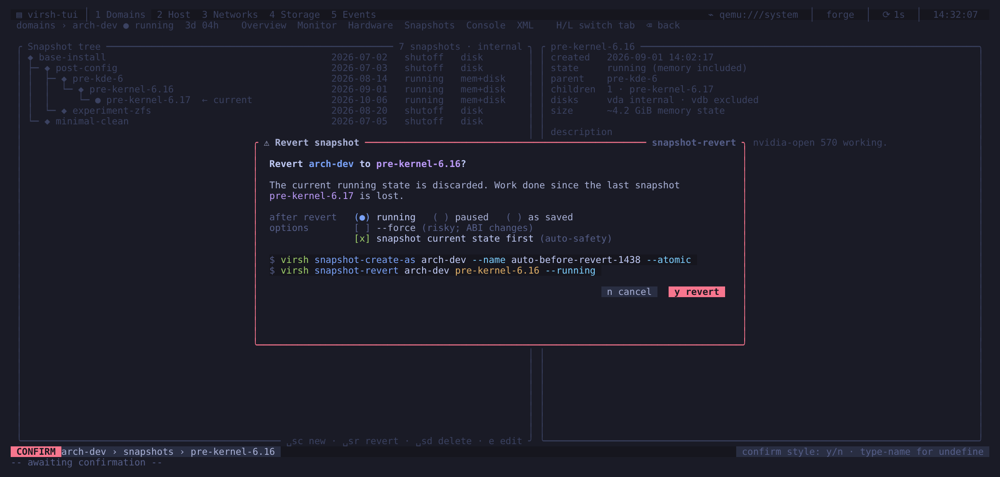
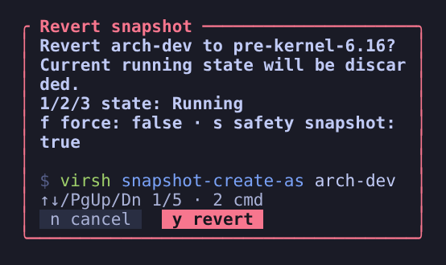

# Domain detail

`Enter` on a domain opens its detail view. `H` and `L` (or `[` and `]`) move
between the tabs; `Backspace` or `q` returns to the list.

## Overview

The domain's configuration at a glance: machine type, firmware, vCPUs,
memory, disks, network interfaces, graphics, autostart, persistence and UUID.

For a running domain with a guest agent channel, a **Guest (qemu-ga)**
section adds what the agent reports (`virsh guestinfo`): the guest's OS and
kernel, its hostname and time zone, the users logged in, and each mounted
file system with its usage. It is read when the detail opens and on `Ctrl-r`.
If `qemu-guest-agent` is not running in the guest the section says so; on a
read-only connection it is not asked (libvirt allows it only read-write).

The guest agent also gives the IP address of domains on a bridge, where
there is no DHCP lease to read, and `:shutdown <domain> --mode agent` for
guests that ignore ACPI. To set a password in the guest, type the virsh
command with a leading space so it is not saved in the history:
`: set-user-password <domain> <user> <password>`.

## Monitor

Live graphs for the running domain: total CPU and one meter per vCPU, memory
with balloon and RSS, read and write rates per disk, and receive and transmit
rates per interface. `t` cycles the history window between 60 seconds,
5 minutes and 1 hour. Samples are kept for an hour while virsh-tui runs, so
switching windows does not lose data.

The numbers come from `virsh domstats`, one call per refresh for all domains.
Balloon statistics need a guest driver and a stats period. virsh-tui leaves
the period alone unless you enable `monitoring.balloon_on`, because setting it
changes the running guest.

## Hardware

The hardware editor lists the devices on the left (CPUs, memory, boot
options, disks, CD-ROMs, NICs, display, video, sound, input, TPM, USB
redirection) and the selected device's form in the middle. The right column
shows the XML diff of your pending changes and, below it, the commands that
`:w` will run.

Below 150 columns the editor takes priority over the side panels. `F6`
opens the full XML diff and command review in either editing mode; `Esc` or
`F6` returns. Arrows scroll vertically or pan horizontally, `PageUp`/`PageDown`
page, and `Home` resets the review. The focused field follows the viewport.

In NORMAL mode:

| Key | Action |
|-----|--------|
| `j` / `k` | move between devices |
| `Tab` / `Shift-Tab` | next / previous field of the form |
| `i` | edit the focused field (INSERT mode) |
| `a` | add a device of the selected kind: prefills `:attach-disk`, `:attach-interface` or `:attach-hostdev` with the domain |
| `d` | detach the selected device, confirms (`--live` only on a running domain) |
| `h` / `l`, `J` / `K` | on Boot options: select a boot entry, move it down / up |
| `u` | undo the changes to the focused field |
| `:w` | apply the pending changes |
| `:q!` | discard them |
| `gx` | jump to the XML tab |
| `Space m i` / `Space m e` | insert / eject an ISO on the CD-ROM (opens the media picker in Storage) |

In INSERT mode, typing edits the field (upper-case letters included) and
`Backspace` deletes; INSERT keeps every key until `Esc`. Number fields take
digits only, size fields digits and a binary unit (`512M`, `8G`, `1.5T`). On
number fields, `Ctrl-a` / `Ctrl-x` or `l` / `h` add or subtract 1, and `L` /
`H` add or subtract 10. `Space` toggles check boxes and radio options.
`Enter` or `Tab` moves to the next field, `Esc` goes back to NORMAL mode.

`:w` refuses invalid values with the reason (missing unit, empty field,
current above maximum, a disk size smaller than the disk). A disk "new size"
runs `blockresize` on a running domain and `vol-resize` on its image when it
is shut off. Raising vCPUs or memory past what the running guest booted
with is saved to the configuration and noted in `:messages` as needing a
restart. `q`, the view keys and `Space m i` refuse to leave the domain while
edits are pending. A key that completes a sequence (the `i` of `Space m i`)
belongs to that sequence, not to the single-key shortcut.

Changes are applied to the persistent configuration (`--config`), to the
running domain (`--live`), or both, depending on the "Apply to" boxes at the
bottom of each form. Fields that only take effect after a reboot are marked
with `⚠ needs reboot`. The editor writes a new XML and runs
`virsh define --validate`, so libvirt rejects invalid combinations before
anything changes.

## Snapshots

The snapshot tree, with the current snapshot marked, each snapshot's date
and kind (`disk`, `mem+disk`), and the details and description of the
selected one (from `virsh snapshot-dumpxml`). Snapshots whose parent no
longer exists are shown as roots. Revert and delete are refused when there
is no snapshot. In the creation form, use Tab to select the name, description, atomic option or quiesce option; Space toggles an option. Snapshot XML editing is disabled in demo and dry-run modes.

| Key | Action |
|-----|--------|
| `j` / `k` | select a snapshot |
| `Space s c` | create a snapshot (name, description, flags) |
| `Space s r` | revert to the selected snapshot, confirms |
| `Space s d` | delete the selected snapshot, confirms |
| `e` | edit the snapshot XML (`virsh snapshot-edit`) |

## Console

Shortcuts for the serial console (`c`, which runs `virsh console`) and the
graphical viewer (`v`). Inside the console, `Ctrl-]` returns to virsh-tui.
The escape key can be changed with `console.escape`.

## XML

The live XML with syntax highlighting. `j`/`k`, `Ctrl-d`/`Ctrl-u` and
`gg`/`G` scroll. `e` opens it in your editor; when you save and quit,
virsh-tui runs `virsh define --validate` and reopens the editor with the
error if libvirt rejects the file, as `virsh edit` does. Closing the editor
without changes defines nothing.

Only the visible XML page is highlighted, so scrolling large definitions avoids
rebuilding the full highlighted document. Line positions above 65,535 are supported.
