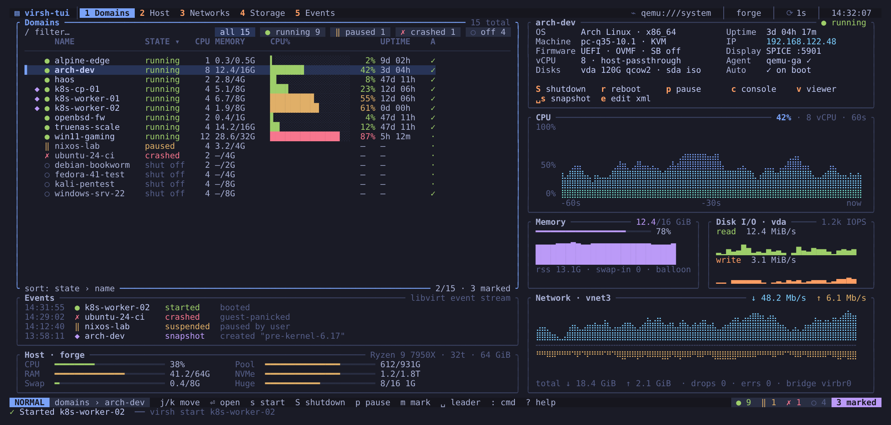

# Domains

The domains view is the start screen. The list on the left shows every domain
on the connection with its state, vCPUs, memory, a CPU bar, uptime and
autostart flag. The right-hand side follows the selection: an overview with
the OS, machine type, firmware, IP address, display and guest agent status,
then CPU, memory, disk and network graphs. On narrower terminals the graphs
move under the list, with tabs (Overview, CPU, Mem, Disk, Net) that `[` and
`]` switch.

Below the list are the most recent libvirt events and a summary of the host:
CPU, memory, swap, hugepages and the two largest storage pools.

## Finding domains

| Key | Action |
|-----|--------|
| `j` / `k` | move down / up |
| `gg` / `G` | first / last domain |
| `Ctrl-d` / `Ctrl-u` | half a page down / up |
| `/` | filter by name as you type (`#tag` filters by tag); `Enter` keeps the filter, `Esc` clears it |
| `n` / `N` | next / previous match |
| `f` / `F` | cycle the state chips: all, running, paused, crashed, off |
| `o` | cycle the sort order: state, name, CPU, memory, uptime (longest first) |
| `:42` | jump to row 42 |

## Lifecycle

| Key | Action | virsh command |
|-----|--------|---------------|
| `s` | start | `virsh start` |
| `S` | ACPI shutdown | `virsh shutdown` |
| `D` | destroy (force off), confirms | `virsh destroy` |
| `r` | reboot | `virsh reboot` |
| `R` | reset (hard), confirms | `virsh reset` |
| `p` | pause or resume (per domain) | `virsh suspend` / `virsh resume` |
| `Z` | save state to disk and stop, confirms (`ZZ` quits) | `virsh managedsave` |
| `a` | toggle autostart (per domain) | `virsh autostart [--disable]` |
| `X` | undefine, asks you to type the name | `virsh undefine --keep-nvram --snapshots-metadata --managed-save` |
| `Space c` | clone: prefills `:clone <name> <name>-clone` to edit the new name | `virt-clone` |

The cursor stays on the same domain while CPU or uptime re-sort the list.
`undefine` keeps the UEFI variables file and the disks, and drops snapshot
metadata and a managed-save image, without which virsh refuses.

After `S`, virsh-tui watches the domain. If it is still running after the
grace period, the message line says the guest ignored the request, and you
can retry or use `D`.

## Tags

Tags group domains your way (`web`, `prod`, `k8s`). They are stored in the
domain's own XML, as libvirt metadata in virsh-tui's namespace, so they
survive a restart, show up in `virsh dumpxml` and follow the domain to
another host.

`Space t` puts `:tag <domain> +` on the command line. Then:

| Command | Effect |
|---------|--------|
| `:tag web-01 +prod +web` | add tags |
| `:tag web-01 -prod` | remove a tag |
| `:tag web-01 db backup` | replace all tags |
| `:tag web-01 --clear` | remove all tags |
| `:tag web-01` | show the tags |

Tags are letters, digits, `-`, `_` and `.`, up to 32 characters. They run
`virsh metadata … --config` (and `--live` on a running domain). The selected
domain's tags appear in its panel title (`web-01 · #prod #web`), and `/#prod`
shows only the domains tagged `prod` (a prefix is enough; `/#` shows every
tagged domain). Mark them with `V` and `G` to act on the whole group.

## Console, viewer and XML

| Key | Action |
|-----|--------|
| `c` | serial console (`virsh console`); `Ctrl-]` returns to virsh-tui |
| `v` | graphical viewer (`virt-viewer`, or `remote-viewer` if configured) |
| `e` | open the XML in your editor, then `virsh define --validate` it |
| `Space x` | save the XML as `./<name>.xml` in the current directory (never overwrites) |

## Copying

| Key | Copies |
|-----|--------|
| `yy` | domain name |
| `yu` | UUID |
| `yi` | first IP address |
| `yc` | the last command virsh-tui ran |

The clipboard keeps its content after the copy (the app stays its owner on
X11/Wayland); in a terminal without a clipboard, OSC 52 is used.

## Several domains at once

Mark domains with `m`, or press `V` and extend the selection with `j`/`k`.
Lifecycle keys then act on every marked domain that is visible (a filter or
chip that hides a marked domain also leaves it out). With more than one
domain the confirmation dialog lists every command before anything runs. A
domain that fails does not stop the others: the message line reports
`n ok / m failed` with the failed names, and `:messages` has each error. The
marks are cleared when the job ends.
