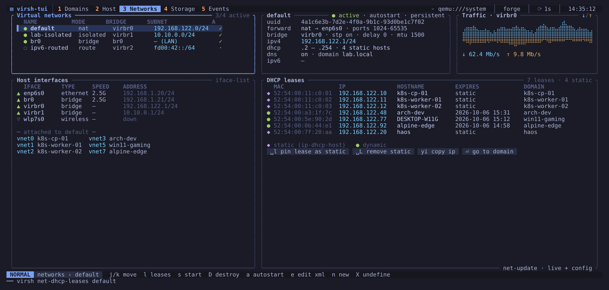

# Networks

The list of virtual networks with their state, autostart, bridge, forward
mode and address range. The selected network's DHCP leases appear next to
it, joined with the static host entries and with the domain that owns each
MAC address, followed by the interfaces attached to the network.

| Key | Action |
|-----|--------|
| `j` / `k` | select a network |
| `l` | move the focus to the leases table (and back) |
| `Enter` on a lease | open the domain that owns it |
| `Space l` | pin the selected lease as a static DHCP host entry |
| `Space L` | remove the static host entry |
| `yi` | copy the lease's IP address |
| `s` | start the network |
| `D` | destroy (stop) the network, confirms |
| `a` | toggle autostart |
| `e` | edit the network XML in your editor |
| `n` | create a network from a short form |
| `X` | undefine the network, confirms |

Pinning a lease runs `virsh net-update … add ip-dhcp-host` on both the live
network and its persistent definition, so the guest keeps its address after a
restart.

## Creating a network

`n` opens the form. The host's address on the network is the address you
type when it is a host address (`192.168.100.254/24`), otherwise the first
host of the subnet (`192.168.100.128/25` gives `192.168.100.129`). Prefixes
from /8 to /30 are accepted. A DHCP range must lie inside the subnet and
must not include that address; left empty, it covers the rest of the subnet.
Bridge names take 1-15 letters, digits, `-`, `_` or `.`. In bridge mode the
network attaches to an existing host bridge and needs no address.
