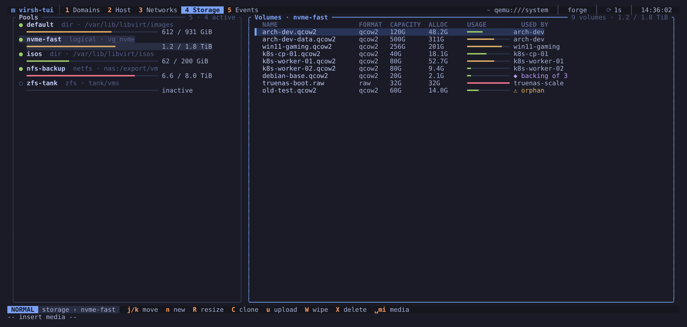

# Storage and media

Storage pools on the left, the selected pool's volumes on the right. Each
volume shows its format, capacity, allocation, backing chain and the domains
that use it. `h` and `l` move the focus between the two lists.

## Pools

| Key | Action |
|-----|--------|
| `s` | start the pool |
| `D` | destroy (stop) the pool, always confirms |
| `b` | build the pool (create its directory or format its device) |
| `r` | refresh the volume list |
| `a` | toggle autostart |
| `N` | create a pool (dialog) |

Inactive pools are listed too, so `s` can start them. The volumes of every
active pool are read when the view opens: moving between pools does not run
`virsh` again, and the volume cursor stays on the same volume after a
refresh or a job.

### Creating a pool

`N` opens the new-pool dialog. Pick the type with `←` / `→`:

| Type | Source | Default target |
|------|--------|----------------|
| `dir` | a folder on this host | `/var/lib/libvirt/images/<name>` |
| `netfs` | NFS server and export path | `/mnt/libvirt/<name>` (libvirt mounts it) |
| `logical` | an existing LVM volume group | `/dev/<vg>` |
| `fs` | a block device with a file system (`/dev/sdb1`) | `/mnt/libvirt/<name>` |

Typing in **Target** starts from the suggested path. The dialog runs
`pool-define-as`, then, if checked, `pool-build` (only for `dir` and
`netfs`, where it just creates the folder; for `fs` it could format the
device, so it is never offered), `pool-start` and `pool-autostart`. The
commands are shown as you fill in the form; `Enter` runs them as one job
and the view reloads afterwards.

## Volumes

| Key | Action |
|-----|--------|
| `n` | create a volume (name, size, format) |
| `R` | resize: prefills `:vol-resize <vol> --pool <pool>` |
| `C` | clone: prefills `:vol-clone <vol> --pool <pool>` |
| `u` | upload a local file into the volume: prefills `:vol-upload <vol> --pool <pool>` (confirms: it overwrites the volume) |
| `W` | wipe the volume with zeros, confirms |
| `X` | delete the volume, confirms |

The USED BY column lists the domains whose disks use the volume, by path or
as `<source pool= volume=>`, in the stored and in the running configuration
(including backing files of running guests), and `◆ backing of N` when other
volumes, in any pool, are backed by it. `⚠ no domain` means nothing above
references it; `? unknown` means a pool or domain could not be read, so
nothing is labelled unused.

## Inserting and ejecting ISO media

`Space m i` opens a picker with the ISO images found in your pools. Choosing
one inserts it into the domain's CD-ROM drive with
`virsh change-media … --insert`, on the running domain and its configuration.
If the domain has no CD-ROM drive, virsh-tui offers to attach one.
`Space m e` ejects the current medium. With several CD-ROM drives, media
goes into an empty drive and eject takes the drive that holds media; use
`:media <domain> <target> <iso>` for a specific drive. The picker moves with
`Ctrl-j` / `Ctrl-k` or the arrow keys. From the `:` line,
`:attach-iso <domain> <path>` does the same with a path you type, with Tab
completion for the file name.
