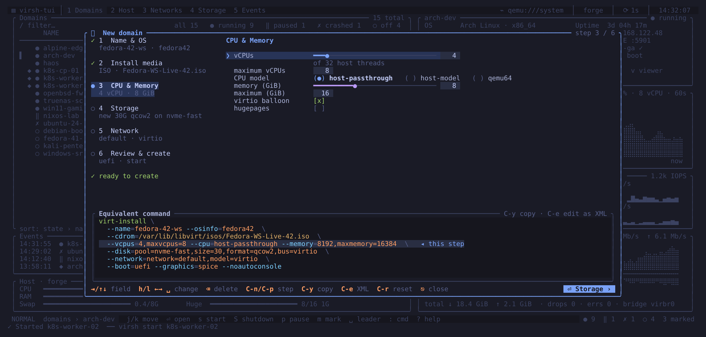

# Creating a domain

`Space n` opens the new domain wizard. On a remote connection the first
`Space n` reads the host's CPU and memory with `virsh nodeinfo` /
`nodememstats` (press it again a moment later). It collects what `virt-install` needs
in six steps and shows the resulting command at the bottom, highlighting the
part that belongs to the current step. The command shown is the one that
runs.

| Step | Fields |
|------|--------|
| 1. Name & OS | name, OS variant (osinfo), title, description |
| 2. Install media | local ISO, URL install tree with kernel arguments, PXE, import an existing disk, or none |
| 3. CPU & memory | vCPUs and maximum, CPU model, memory and maximum, balloon, hugepages |
| 4. Storage | a new disk (pool, size, format, bus) or an existing image |
| 5. Network | a virtual network (or none), NIC model, fixed or automatic MAC |
| 6. Review & create | firmware (UEFI or BIOS), secure boot, TPM 2.0, graphics, start after creation, open viewer, autostart |

The left column lists the steps with a one-line summary each and a checklist
of what still blocks creation, such as a missing name or ISO path.

The CPU model defaults to `host-passthrough`. On a local host without KVM
(no `/dev/kvm`, for example inside a VM without nested virtualization),
libvirt can only emulate the guest and rejects `host-passthrough`, so the
wizard uses `host-model` and lists `host-passthrough` as a blocking problem.

## Keys

| Key | Action |
|-----|--------|
| `Tab`, `↓`, `Ctrl-j` | next field |
| `Shift-Tab`, `↑`, `Ctrl-k` | previous field |
| letters, digits | type into text and number fields |
| `Backspace` | delete the last character |
| `Ctrl-w` | clear the field |
| `h` / `l`, `←` / `→` | change a choice, or adjust a number by 1 |
| `H` / `L` | adjust a number by 10 |
| `Space` | toggle a check box or cycle a choice |
| `Ctrl-n` / `Ctrl-p` | next / previous step |
| `Enter` | next step; on the last step, create the domain |
| `Ctrl-y` | copy the `virt-install` command |
| `Ctrl-e` | edit the generated XML in your editor, then define it |
| `Ctrl-r` | reset the wizard to its defaults |
| `Esc` | close; the draft is kept |

In text fields every printable key types, including `h`, `l` and `y`.

## Defaults and the OS variant

A new wizard starts with 2 vCPUs (maximum 4), 4 GiB of memory (maximum
8 GiB), a 20 GiB qcow2 virtio disk in the first active pool, a virtio NIC on
the first active network, UEFI firmware and SPICE graphics.

Leave the OS field empty and virsh-tui passes
`--osinfo detect=on,require=off`, so `virt-install` detects the OS from the
media itself; the field's hint shows a guess from the ISO name, but the guess
is never passed (a wrong id would make `virt-install` fail). Type an id to
force it; `virt-install --osinfo list` shows the accepted names.

The form refuses 0 vCPUs or 0 GiB of memory, and a maximum memory above the
memory when the balloon is off (the guest would always get the maximum).

## Creating

`Enter` on the last step checks the form. If something is missing, the
wizard jumps to the step that needs it and says what is wrong. Otherwise it
runs `virt-install … --noautoconsole` against the current connection.

- With "start after creation" off, virsh-tui asks `virt-install` for the XML
  (`--print-xml`) and defines the domain without booting it.
- With "open viewer" on, the graphical viewer opens once the domain starts.

Errors from `virt-install` are shown in the wizard, so you can fix the field
and try again.

## Drafts

The wizard saves a draft on every change and when you close it. The next
`Space n` restores it. A successful creation deletes the draft; `Ctrl-r`
starts over. The draft lives in `~/.local/state/virsh-tui/wizard-draft.toml`.
